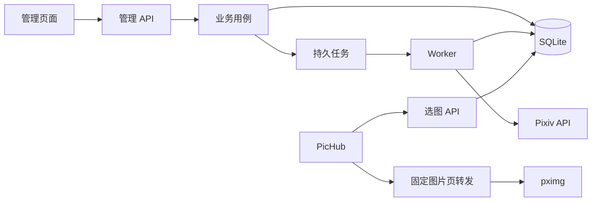

# 详细设计

版本：0.1；更新日期：2026-10-08；状态：**逐阶段实现的设计基线**。

已实现数据存储、事务迁移、持久队列、管理鉴权、画师手动导入/审核与任务管理的一部分，现有能力以 README 和 [开发计划](development-plan.md) 为准。其余接口及页面仍为设计契约。

## 1. 产品目标与边界

建立用户自己的 Pixiv 目录和偏好选图服务，作为 PicHub-Aggregator 的一个图源。

确认的用户流程：
1. 导入已关注画师，选择进入本地采集名单的画师。
2. 根据已有关注和作品样本推荐其他画师。
3. 查看代表作预览，手动确认候选。
4. 自动采集确认画师的作品 ID、元数据和每页 URL。
5. 按偏好通过接口选择一张图片。
6. PicHub 下载原图、缓存、收藏和分发。

推荐候选不得自动批准。本地批准不触发 Pixiv 远端关注；取关不删除已有目录。系统不把账号写操作与采集动作混在一起。

Curator 不持久缓存原图，不做下载归档。管理预览与原图端点可以按需流式转发，上游字节仅经过内存中的有限缓冲区。

第一版单用户、单账号；静态插画和漫画分页作为供图范围。ugoira 可记录元数据，但不作为普通静态原图供给 PicHub，不实现动画转换。

## 2. 技术与运行结构

- 核心：Go 1.26+，HTTP 使用 net/http，日志使用 log/slog。
- 数据：SQLite，纯 Go 驱动 modernc.org/sqlite v1.60.1 已锁定。
- 页面：优先 html/template + 少量原生 JavaScript，资源嵌入同一二进制；必要时再评估独立前端。
- 部署：第一版一个进程内包含 HTTP、Scheduler 和受控 Worker，共用一个本地数据库。
- 初始 Worker 并发 1；只有测量证明必要时增加并发。不要启动多个 API 实例共用 SQLite 文件。
- Pixiv 客户端与数据库通过接口隔离，离线测试使用固定响应样本。

计划目录（业务包尚未创建）：

```text
cmd/api/                    启动、依赖装配、退出
internal/config/            配置加载和校验
internal/httpapi/           路由、中间件、请求响应
internal/app/               业务用例与事务边界
internal/domain/            实体、状态、错误与业务规则
internal/store/sqlite/      repository、事务、迁移
internal/pixiv/             OAuth、App API、响应归一化
internal/jobs/              调度、租约、重试和处理器
internal/recommend/         画像、召回、评分
internal/selection/         过滤、权重与近期去重
internal/media/             URL 校验、原图与预览转发
internal/admin/             模板和静态资源
migrations/                 带版本的数据库变更
```

HTTP 和任务都调用 app 用例；app 依赖 domain 与存储/客户端接口。不要让 handler 直接混合 SQL、OAuth 和上游抓取。



## 3. 数据模型

### 3.1 通用约定

- Pixiv ID 在数据库使用正整数范围的 64 位整型；HTTP JSON 使用十进制字符串，避免浏览器数值精度问题。
- page_index 从 0 开始，(illust_id, page_index) 唯一。
- 时间统一 UTC，SQLite 使用 Unix 毫秒 INTEGER；API 输出 RFC3339 字符串。
- 所有主表有 created_at、updated_at；上游时间单独保存。
- 原始枚举与业务枚举分离，不能直接复用旧项目内部的 AI/R18 数值含义。
- 标签保留展示文本与规范键，不自动把不同语言标签认作同一标签。
- 数据保留与可供图资格分离；隐藏、屏蔽、不可用不等于删除数据库记录。

### 3.2 表与核心字段

以下为完整 schema 契约；目录与任务表已创建，推荐、偏好事件、选图历史表留待对应阶段迁移。

| 表 | 核心字段 | 约束与用途 |
| --- | --- | --- |
| artists | id, name, account, avatar_url, review_status, collection_enabled, remote_followed, last_seen_follow_run, last_synced_at | id 为 Pixiv UID；审核状态与远端关注独立 |
| artist_sources | artist_id, source_type, source_key, first_seen_at | 三元唯一；记录 following/manual/recommend 来源 |
| artworks | id, artist_id, title, caption, kind, page_count, rating, ai_status, bookmarks, views, published_at, metadata_state, visible | 外键 artists；id 为作品 ID；上游指标允许 NULL |
| image_pages | illust_id, page_index, original_url, preview_url, width, height, media_state, failure_count, last_ok_at, last_error_code | 复合主键；URL 不作为身份；错误内容必须脱敏 |
| tags | id, normalized_name, display_name | normalized_name 唯一 |
| artwork_tags | illust_id, tag_id | 复合主键；完整标签列表获取成功后整体替换 |
| artist_sync_state | artist_id, phase, cursor, run_id, last_full_sync_at, last_incremental_at | 单次扫描进度；不依赖本机内存续跑 |
| recommendation_runs | id, state, input_version, budget_json, started_at, finished_at, stats_json | 保存规则与画像版本，便于解释结果 |
| recommendations | run_id, artist_id, score, reasons_json, sample_illust_ids_json | (run_id, artist_id) 唯一；候选不自动供图 |
| artwork_preferences | illust_id, value, updated_at | 每作品一条当前偏好：like/dislike/neutral |
| feedback_events | id, external_event_id, illust_id, action, source, created_at | 外部 event_id 非空时唯一；保留审计及未来回传 |
| jobs | id, kind, dedupe_key, payload_json, state, attempt, available_at, lease_token, lease_until, cancel_requested, error_code | 持久任务；活跃 dedupe_key 唯一 |
| selection_history | id, collection, illust_id, page_index, selected_at, request_id | 原子近期预留；记录选中，不宣称曝光/喜欢 |
| settings | key, value_json, version, updated_at | 非敏感偏好与规则；不保存 plaintext token |
| schema_migrations | version, applied_at | 显式版本升级 |

不把 OAuth token 放入普通 settings 或 jobs.payload；任务只引用本地账号标识。

推荐候选的样本可以写入 artworks/image_pages，但其画师仍为 pending；所有供图查询必须 join artists 检查资格。该约束防止“为了显示预览抓了作品，就意外进入随机图库”。

### 3.3 索引与写入

必要索引：
- artists(review_status, collection_enabled)。
- artworks(artist_id, published_at, id)、artworks(visible, metadata_state, rating, ai_status)。
- artwork_tags(tag_id, illust_id)。
- jobs(state, available_at)、活跃状态 dedupe_key 的部分唯一索引。
- selection_history(collection, selected_at)、selection_history(illust_id, page_index, selected_at)。

开启 foreign_keys 和 WAL，设置有界 busy_timeout；写入使用短事务。第一版写连接上限为 1，任务事务与 API 写入串行化，网络调用放在事务外。

大批导入分批提交；每批数据与其 cursor 在同一事务中提交。SQLite 文件必须位于本地可靠磁盘，不能将网络文件共享当成并发数据库。

## 4. 状态规则

### 4.1 画师审核与采集

| 状态 | 可展示预览 | 可全量采集 | 可正式供图 |
| --- | --- | --- | --- |
| pending | 管理端可以，受样本预算限制 | 否 | 否 |
| approved | 是 | collection_enabled=true 时可以 | 满足作品过滤时可以 |
| rejected | 管理端可查看已有资料 | 否 | 否 |
| blocked | 管理端可查看已有资料 | 否 | 否 |

collection_enabled 只控制后续采集。approved 画师暂停采集后，已有入选作品仍可供图；停止供图使用 blocked 或作品 visible=false，UI 必须解释区别。

- 首次同步关注只导入记录，可由用户批量确认；不直接把大量关注对象视为已审核。
- 推荐只能创建/更新 pending；不能覆盖 approved/rejected/blocked。
- rejected 默认不再自动推荐，用户可显式恢复为 pending。
- blocked 需显式解除；解除后回到 pending，不能自动恢复采集。
- 确认操作在同一事务内更新 approved、启用采集并插入去重任务。
- 屏蔽后取消待执行任务；正在执行的任务每批写入前重新检查状态，必要时终止。
- 最终选图与图片转发都再次检查资格。已经被 PicHub 缓存的文件不受 Curator 屏蔽追溯删除。

### 4.2 内容归一化

kind：illust / manga / ugoira / unknown。

rating：safe / r18 / r18g / unknown。

ai_status：non_ai / ai / unknown。

metadata_state：pending / complete / unavailable。

media_state：indexed / unavailable。indexed 仅表示已取得通过格式校验的 URL，不代表刚做过连通性探测；实际访问时间由 last_ok_at 表示。

缺失、非法或不认识的上游枚举均映射 unknown。默认仅允许 safe + non_ai + 静态图片，未知分类进入补全队列，不猜测分类。

## 5. 后台任务

### 5.1 类型

| kind | 输入引用 | 责任 |
| --- | --- | --- |
| sync_following | account_id, run_id | 拉取全部关注分页并完成快照 |
| sync_artist | artist_id, phase | 首次/增量作品列表扫描 |
| hydrate_artwork | illust_id | 补全缺失元数据和分页链接 |
| recommend_artists | run_id | 画像、召回、候选采样、评分 |
| repair_media | illust_id | 刷新作品详情与 URL |

默认同步周期提议为 6 小时，可配置；推荐第一版由用户手动触发。首次上线先用少量画师验证，再启用周期调度。以上是待实现默认，不是现有配置。

### 5.2 状态与租约

```text
pending -> running -> succeeded
running -> retry_wait -> running
running -> failed
running -> paused_auth -> pending（修复凭据后显式恢复）
pending/retry_wait/paused_auth -> canceled
running --取消请求--> 批次边界安全退出 -> canceled
```

任务按至少一次执行设计，不承诺 exactly-once。Worker 在短事务内抢占任务并生成新的 lease_token，之后在事务外访问网络。

- 初始租约 90 秒，每 20 秒续约；网络请求超时不超过 20 秒。
- 完成、游标更新和批量数据写入必须在同一事务校验 lease_token 与未过期 lease。
- 过期执行者即使返回成功结果也不能继续提交，避免重启后的旧任务覆写新任务。
- 过期 running 进入 retry_wait，保留 cursor。超过尝试预算进入 failed。
- 活跃任务去重状态包含 pending/running/retry_wait/paused_auth；结束后允许新一轮相同业务任务。
- 同一账号遵守串行请求与冷却；任务并发增加也不能突破账号限速。

### 5.3 重试和错误分类

- 网络超时、连接错误、5xx：指数退避加抖动，默认最多 5 次，基准 2 秒，上限 5 分钟。
- 429：遵守可解析 Retry-After，暂停该账号的新请求；不能用立即换号代替退避。
- 401：一次受控刷新后重试；仍失败则 paused_auth，等待凭据修复。
- 403：按上游错误类别区分限制、认证与暂时风控，无法确定时保留目录并暂停/重试，不直接删除。
- 明确的作品不存在/不可访问：标记 unavailable，保留历史信息；不因一次网络错误做同样处理。
- 业务校验失败：failed，记录稳定错误码，错误摘要去除凭据和完整敏感响应。

## 6. Pixiv 认证与采集

### 6.1 凭据

首版单账号。refresh token 从配置的私密文件导入，文件权限 0600、目录 0700；不加入 Git。访问令牌仅驻留内存。

刷新使用进程内互斥协调：等待者共享本次刷新结果。轮换后的 refresh token 采用同目录临时文件、flush 和原子 rename 保存；持久化失败必须暂停后续刷新并记录脱敏错误，不能假装已保存成功。

账号状态接口只返回 configured / ready / expired / error，不回显 token。备份目录与凭据恢复分开说明。

App API 页码/next_url 必须验证固定上游域与协议，不能无校验地跟随响应中的任意 URL。图片请求不携带 App API Authorization。

### 6.2 关注快照

sync_following 使用新的 run_id 逐页 upsert，记录 last_seen_follow_run。只有完整分页成功后，才将本轮未见的记录标为 remote_followed=false。

同步中断或达到暂时预算时，不提前判定未出现者已经取关。远端关注变化不会覆盖本地审核状态和作品保留状态。

### 6.3 作品扫描

首次扫描逐页枚举，批次提交作品、分页 URL、标签与 cursor。已有数据优先复用，缺失字段才安排 hydrate。

增量以新的扫描 run 从第一页开始。第一版以完整分页扫描保证目录完整，可跨多次调度按持久 cursor 续跑；不会“遇到一个旧作品就停止”。只有在实网证实分页排序与更新语义后才引入时间窗口优化，且保留定期全量核对。

列表返回顺序不作为身份或去重依据。每个作品使用 ID upsert，每张图片使用作品 ID+页索引 upsert。页数变化仅在详情完整成功后更新页面集合；失效页保留 unavailable 状态，避免部分响应误删数据。

## 7. 推荐与个人偏好

### 7.1 候选与人工确认

输入来自已关注画师的有限作品样本，结合 approved 画师和显式作品反馈。pending 推荐样本不能循环扩大正反馈画像。

召回来源分阶段接入：相关画师、相关作品的画师；可选推荐流和标签搜索。每个来源有样本上限与总请求预算，一种可选来源失败不应清空其他候选。

默认建议预算：最多 30 位种子画师、每画师 8 件样本、最多 60 位候选、每候选 4 件样本；推荐任务总外部请求上限 300。数值为初始配置提案，需小样本实网校准，允许结果不足。

排除已 approved、rejected、blocked；同一 UID 合并多个来源的证据。缺少足够样本的候选标记低置信度，不伪造精确审美分数。

候选界面显示：画师信息、代表作预览、来源、主要标签、推荐理由、样本数量和更新时间。明确确认后才创建正式采集任务。

### 7.2 第一版评分

仅使用可解释规则，不要求机器学习模型：
- 标签画像按画师均衡聚合，避免高产作者支配画像。
- 标签、来源证据、质量统计均归一化到 0–1。
- 建议初始分数：0.55 标签匹配 + 0.25 多源证据 + 0.20 样本质量 - 负偏好惩罚，最终截断到 0–1。
- 质量统计使用样本收藏中位数等稳健指标，不让单个爆款决定全部评分。
- 记录 score_version 与分项，权重属于配置，需要通过用户反馈迭代。

分数是启发式排序值，不是“喜欢概率”。标签方法对配色、笔触和构图的理解有限，视觉模型留待以后。

### 7.3 作品反馈

artwork_preferences 保存当前 like/dislike/neutral，显式 dislike 作为硬排除。重复设置相同值幂等；修改为 neutral 撤销当前偏好，不抹除审计事件。

收藏、喜欢、屏蔽要分清。第一版在本项目页面操作偏好；PicHub 原有喜欢接口不是作品偏好接口。未来反馈回传必须带稳定作品标识和唯一 event_id。

## 8. 选图

### 8.1 资格与过滤顺序

1. 画师 approved；作品 visible；元数据满足请求需要；静态图片页 indexed。
2. 全局偏好规则。
3. 请求条件进一步收窄，不能放宽全局排除。
4. 用户作品 dislike、作者 blocked 等硬排除。
5. 近期去重与抽样策略。

偏好改动可通过查询时过滤即时生效，第一版不需要全量复制一份“入选库”。

### 8.2 作者均衡与去重

第一版先从符合筛选的画师中抽样，再从该画师符合条件的图片中选择，避免高产画师按页数占满结果。此策略不是全图库每页等概率，必须在设置说明中明确。

- 近期去重默认作用于单用户 preferred 集合，排除最近 20 次选中的作品，最长保留 30 分钟；同一作品不同页也被短期排除。
- 在事务中选择并写 selection_history；并发请求不能先读后无锁地重复占位。
- 过滤后有图但均在近期窗口：允许重复最久未选中的合格作品，并在 JSON 标记 repeated=true。
- 小库降级只放宽近期去重，不放宽审核、内容、标签或人工排除规则。
- 选图日志表示 selected；PicHub 自动预取也会消耗选图次数，不据此训练偏好。
- 每次选择写入时在同一事务内保留本集合最近 20 条，清理更旧记录；进程每分钟额外删除超过 30 分钟的记录，启动时也执行一次。长期统计单独聚合，不能依赖无限增长的 selection_history。

选择查询先使用明确可维护的索引和有界抽样；数据库规模明确后再优化，不预先引入单独的 Go 随机引擎。

## 9. HTTP 接口契约

### 9.1 现有端点

| 方法 | 路径 | 当前行为 |
| --- | --- | --- |
| GET | /healthz | 200，status=ok；只表示进程存活 |
| GET | /version | 200，name/version |

当前未知路由返回 404；下面的业务 API 均未实现。

### 9.2 计划供图接口

| 方法 | 路径 | 作用 |
| --- | --- | --- |
| GET | /random?format=json&collection=preferred | 返回一张图片的稳定地址和身份 |
| GET/HEAD | /i/{illust_id}/{page_index} | 原图流式转发；HEAD 仅响应头，不发送图像体 |
| GET | /readyz | 本地库/迁移/Worker 就绪检查，不请求 Pixiv |

第一版 collection 仅接受 preferred，format 仅接受 json，均可省略并使用此默认。未知参数或枚举返回 422，不声称兼容参考站所有参数。

计划支持：
- orientation=any|portrait|landscape|square。
- r18=0|1|2：0 为 safe，1 为 r18/r18g，2 为所有已知级别；unknown 始终不隐式包含。全局若禁止成人内容，请求不可绕过。
- ai_type=0|1|any：non_ai / ai / 已知两类；unknown 排除，全局限制仍适用。
- min_width、min_height：正整数，单位像素。
- included_tags：重复参数为 AND，单值中的 | 为 OR。
- excluded_tags：任意匹配即排除。
- user_id：已 approved 的指定画师 UID。
- strategy=balanced|random：balanced 使用作者均衡；random 在合格图片中抽样。两者均遵守硬过滤与去重。

默认不传筛选参数时采用持久化的个人偏好；不能用接口默认值覆盖用户已保存的规则。

成功示例：

```json
{
  "url": "https://curator.example/i/12345678/0",
  "illust_id": "12345678",
  "page_index": 0,
  "artist_id": "876543",
  "width": 1920,
  "height": 1080,
  "selection_id": "opaque-id",
  "repeated": false
}
```

url 从配置的 PUBLIC_BASE_URL 构造，必须让实际消费方可达；不直接信任客户端 Host 构造地址。/random 使用 Cache-Control: no-store。

原图端点应固定作品页，可刷新该页的源站 URL，但不能换成另一件作品。无匹配结果返回 404 NO_MATCH；目录尚为空返回 503 CATALOG_EMPTY；本地依赖未就绪返回 503 NOT_READY。

统一业务错误：

```json
{
  "error": {
    "code": "NO_MATCH",
    "message": "没有符合当前条件的图片",
    "request_id": "opaque-id"
  }
}
```

### 9.3 管理 API（计划，全部鉴权）

| 方法 | 路径 | 语义 |
| --- | --- | --- |
| GET | /admin/api/artists | 筛选/分页画师 |
| POST | /admin/api/artists | 手动 UID 导入为 pending |
| POST | /admin/api/following/sync | 创建同步任务，返回 202 + job_id |
| POST | /admin/api/artists/{id}/approve | 确认并自动入队，幂等 |
| POST | /admin/api/artists/{id}/reject | 拒绝候选，不删除历史 |
| POST | /admin/api/artists/{id}/block | 停止供图与采集 |
| POST | /admin/api/artists/{id}/restore | rejected/blocked 恢复 pending |
| PATCH | /admin/api/artists/{id} | 仅编辑 collection_enabled 等白名单字段 |
| POST | /admin/api/artists/approve-batch | 批量确认，每项返回结果；每画师事务保证批准与入队一致 |
| POST | /admin/api/recommendations | 新建有预算的推荐任务，返回 202 |
| GET | /admin/api/recommendations | 按 run_id 查询候选 |
| GET | /admin/api/artworks | 按画师、标签、状态查询作品 |
| GET/HEAD | /admin/api/previews/{illust_id}/{page_index} | 已知样本预览，可服务 pending 候选；只管理端可达 |
| PUT | /admin/api/preferences/artworks/{illust_id} | like/dislike/neutral 幂等设置 |
| GET/PUT | /admin/api/settings/preferences | 查看/更新偏好，使用 version 防止覆盖并发修改 |
| GET | /admin/api/jobs | 查看任务、游标摘要、错误码 |
| POST | /admin/api/jobs/{id}/retry | 显式重试终态任务，遵循业务去重 |
| POST | /admin/api/jobs/{id}/cancel | 请求取消 |
| POST | /admin/api/jobs/{id}/resume | 仅 paused_auth 可用；检查账号状态后恢复 pending |
| GET | /admin/api/account/status | 只返回凭据状态 |
| POST | /admin/api/account/credentials | 写入/更新凭据，不回显 |
| GET | /admin/api/stats | 目录数、状态、任务和近期错误 |

列表使用不透明 cursor，默认 50、最多 200；排序带唯一 ID 作为稳定次序。输入过大返回 413；格式/参数问题返回 422；状态冲突返回 409；未认证返回 401。

## 10. 管理页面与鉴权

第一版页面：账号状态、画师名单、推荐候选、作品目录、任务、偏好设置。

候选卡片至少有画师名、UID、有限预览、推荐理由及确认/拒绝/屏蔽按钮。禁用不能执行的动作，后端仍独立校验；任务入队成功不显示为“采集完成”。

管理 API 支持私密文件配置的 Bearer token；POST /admin/login 是唯一允许未持有会话访问的管理写入口，仍验证提交的 token 并对失败尝试限流。浏览器页面通过此入口建立短期会话，HttpOnly、SameSite=Strict，HTTPS 时 Secure。会话保存在内存，重启失效；POST /admin/logout 撤销会话。页面 Cookie 写操作校验 Origin/CSRF，不将长期 token 放入 URL 或 localStorage。

默认只监听本机。供图 API 第一阶段运行在受控本机/容器内网，不依赖 PicHub 明文图源 Headers 保存秘密。公网暴露需单独完成服务鉴权与部署方案，不能仅把监听改为 0.0.0.0 就视为已具备公网保护。

## 11. 图片转发与故障恢复

两种交付路径：
- 默认固定 /i 地址：Curator 根据目录 URL，带 Referer 流式拉图给 PicHub，不写原图文件。
- 后续可配置直连 URL：PicHub 自行处理 Referer/出口；不会在第一版默认启用。

转发要求：
- 只从已审核目录取目标 URL，拒绝请求参数指定任意上游。每次 /i 请求重新验证 approved、作品 visible、全局内容规则和显式排除，旧 URL 不能绕过新设置；管理预览端点通过独立鉴权访问 pending 样本。
- 第一版仅允许 HTTPS 的配置内 pximg 图片主机；每次重定向重新校验协议、主机、端口和解析地址。
- 拒绝私网/回环目标及含 userinfo 的 URL；代理模式也保持固定上游白名单。
- Pixiv access token、管理 token、Cookie 不传图片 CDN。
- 只转发必要请求/响应头；不透传上游 Set-Cookie。
- 限制响应大小、头部等待和读取空闲时间；客户端断开立即取消上游请求。
- HEAD 不下载完整图片；Range 支持须通过集成测试后启用，未实现时明确按完整响应处理。
- 非 image/*、明确失效、超时等返回有区分的错误，并去重安排 repair_media；一次失败不删除记录。

供图链路不会等待后台修复完成。403/404 修复同一作品 URL 后仍保留相同端点身份。对已被用户屏蔽的画师，Curator 端点停止新请求；无法追溯撤回 PicHub 已保存文件。

## 12. 配置与运维

现有配置另包含数据库路径、PUBLIC_BASE_URL 和管理 token 文件，见 README。Pixiv token 文件字段尚未接入客户端，不作为可用配置公布。

待实现配置分组：
- 本地启动配置：数据库路径、PUBLIC_BASE_URL、管理 token 文件、Pixiv token 文件、日志级别。
- 持久非敏感设置：筛选规则、同步间隔、推荐预算、去重窗口。
- 固定工程限制：最大请求体、转发大小、任务并发上限，通过验证后决定是否开放为配置。

启动顺序：读配置 → 校验文件权限 → 打开库 → 校验/执行迁移 → 初始化客户端 → 恢复任务 → 启动 Worker/Scheduler → HTTP。

退出顺序：停止接收新任务与新 HTTP 请求 → 取消/排空正在执行的任务和请求 → 有界等待 → 关闭数据库。未完成任务由租约恢复，不能先关闭数据库再等待任务落状态。

存活和就绪分开：
- /healthz 不依赖外部服务。
- /readyz 检查本地数据库与 Worker；Pixiv 暂时不可用不应触发进程无限重启。
- 账号失效、近期任务失败和目录空库在管理状态页单独展示。

备份使用 SQLite 一致性备份机制或停止写入后完整备份，不能在 WAL 活跃时只复制主 .db 文件。迁移前备份；恢复验证包括画师决定、图片唯一键、任务游标和偏好版本。凭据文件单独保管。

## 13. PicHub 接入与验证

代码核查基线：PicHub main 562be65092a4c89dbf869c5e957d634f70e83f2f，后续接入时重新核对。

图源配置建议：
- url：Curator 的 /random?format=json&collection=preferred。
- resp_type：json；json_path：url。
- proxy_mode：启用，图片字节下载和保存由 PicHub 完成。
- 本地 categories 只作为 PicHub 图源路由标签，不等同于作品标签。

PicHub 不会自动透传所有 Curator 筛选参数；第一版通过固定图源 URL/default_query 配置不同偏好入口。图片返回的身份字段也不会自动进入 PicHub 数据模型。

需要验证：JSON 提取、相对/绝对地址、容器互通、Referer、预取、多页身份、收藏，以及两层超时配置。Curator 输出的固定 URL 便于追踪，但不会自动解决 PicHub 当前重复下载的问题。

后续反馈扩展需在 PicHub 保存 illust_id/page_index/artist_id，并发送带 event_id 的显式用户事件；不能直接使用“图源权重加一”训练审美。

## 14. 设计验证与演进

离线覆盖：审核状态机、三态/四态内容标记、分页去重、lease fencing、令牌串行刷新、规则过滤、作者均衡、窗口不足降级、固定 URL 身份、重定向限制。

实际联调单独记录：账号条件、画师数量、作品/图片页数量、请求错误率、任务恢复与 PicHub 下载结果；不把离线测试当成 Pixiv 兼容性保证。

需在对应阶段确定的事项：
- DATA-01：SQLite 驱动版本、迁移实现与备份工具。
- PIXIV-01：当前上游响应枚举、认证细节、分页和实际请求预算。
- PICHUB-01：部署网络、可达 PUBLIC_BASE_URL、下载超时。
- PERF-01：实际图库规模下的抽样查询和索引优化。
- 公网部署或多用户需求出现时：独立鉴权方案与存储演进。

参考项目仅提供实现思路，不能由“代码存在”推断实网已可用：
- pixiv-downloader：认证、关注、作品索引。
- pixiv-artist-recsys：标签画像、召回和解释。
- Random-image-api：过滤、目录、供图契约。
- pixivcat-backend：按作品 ID 转发图片。

外部参考：[Random Mage 文档](https://i.mukyu.ru/docs)、[PicHub-Aggregator](https://github.com/Untitled572/PicHub-Aggregator)。本次文档依据此前已核查的本地代码与接口信息，不宣称再次完成实网业务验证。
